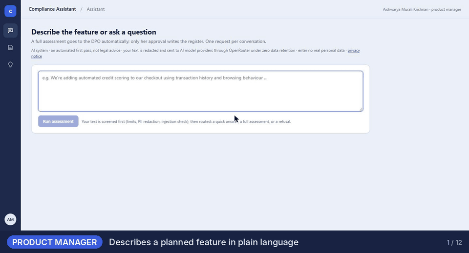
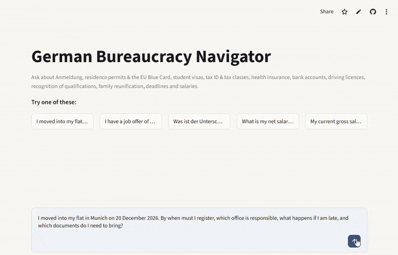
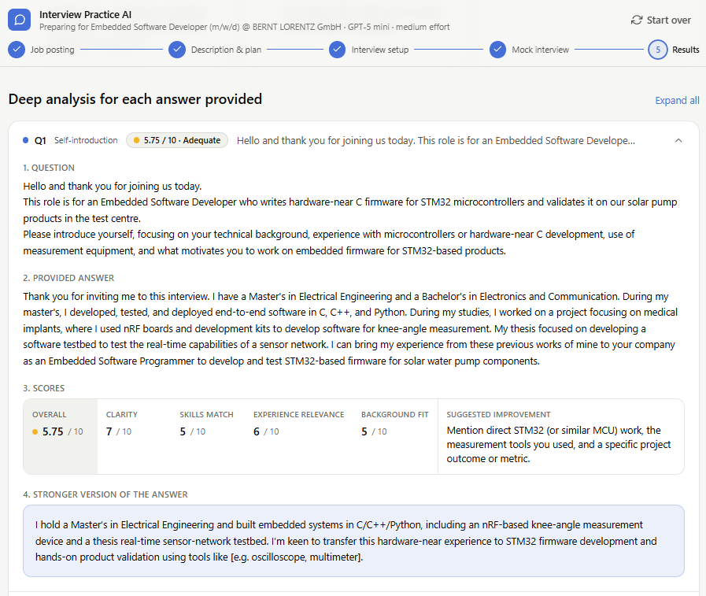

# Hi, I'm Aishwarya

**EN** · I build applications on large language models and take them from an idea to a deployed product. I focus on use cases with complicated source material, such as German administrative rules or EU law, where a general chatbot cannot be trusted. My applications answer from the official sources and cite them. Where a decision has consequences, I build a multi-agent workflow with a human in the loop, so a person makes the final decision. I write safety rules into the code instead of relying on the prompt. I explain the reasoning behind each design choice, and I test and measure how well each application works. Open to junior AI roles in Germany · [LinkedIn](https://www.linkedin.com/in/aishwarya-murali-krishnan-354b44198)

**DE** · Ich entwickle Anwendungen auf Basis großer Sprachmodelle, von der Idee bis zum fertigen Produkt im Einsatz. Mein Schwerpunkt liegt auf Anwendungsfällen mit komplizierten Quellen, etwa deutschen Verwaltungsvorschriften oder EU-Recht, bei denen man einem allgemeinen Chatbot nicht vertrauen kann. Meine Anwendungen antworten auf Grundlage der offiziellen Quellen und nennen diese. Wo eine Entscheidung Folgen hat, baue ich einen Multi-Agenten-Workflow mit Human-in-the-Loop, sodass ein Mensch die letzte Entscheidung trifft. Sicherheitsregeln setze ich im Code um, statt mich auf den Prompt zu verlassen. Ich begründe jede Designentscheidung und teste und messe, wie gut jede Anwendung funktioniert. Offen für Junior-Positionen im KI-Bereich in Deutschland.

**Stack:** Python · TypeScript · LangChain · LangGraph · RAG · RAGAS · FastAPI · Next.js · Streamlit · PostgreSQL · Docker · Git  
**Languages:** English (C2) · German (B2)

---

Below are three LLM applications I designed, built and deployed end to end. All three are live and tested, and each card follows the same structure: the problem it solves, a demo, the stack, a key metric and the main design decisions.

## Compliance Assistant

**The problem.** Before a product team builds a feature, it needs to know whether the GDPR and the EU AI Act allow it, and which articles decide that. The Compliance Assistant turns a plain-language feature description into a first assessment: a verdict, findings with a severity each, and the exact articles behind them. Nothing becomes a record on the assistant's word: the Data Protection Officer (DPO) reviews every assessment, and only an approval writes the organisation's processing register.

**Demo.** [Live app on Render](https://compliance-web-qo1l.onrender.com/login) (sign in with Google as a product manager; the free tier may take a minute to wake up) · [Evaluation report](https://compliance-web-qo1l.onrender.com/evaluation) (no login) · [Project website](https://complianceassessmentagent-site.vercel.app)

**Project stack.** Python · LangGraph · FastAPI · Next.js (React) · PostgreSQL + pgvector · OpenRouter (GPT-6 Luna, Gemini 3.1 Flash Lite) · Docker · pytest · Render · Neon · Vercel

**Key metric: evaluation results.** Evaluated on 100 synthetic inputs in seven test sets, scored with exact rules and an LLM judge from a model family the app never uses. The agentic retrieval loop found 19 of 20 required provisions, against 16 of 20 for a single search. Verdict accuracy was 15 of 20; every miss was one step from the expected verdict, and none was a dangerous one.

| Routing | Injection screen | Retrieval recall | High-risk AI flag | Dangerous misses | Faithfulness |
|:---:|:---:|:---:|:---:|:---:|:---:|
| **44 / 45** | **7 / 7** | **19 / 20** | **19 / 20** | **0** | **0.83** |

**Design decisions.**

| Chose | Rejected | Why |
|---|---|---|
| Human-in-the-loop: the run pauses until the DPO decides | Writing the register automatically | A register entry is a human decision, and not the requester's. Tests check that only the DPO's approval writes the register. |
| Agentic RAG: grade the passages, rewrite the query, search again (up to three attempts) | A single search | One search often misses the decisive article. The loop raised retrieval recall from 16 to 19 of 20. |
| A classifier model as the router, with an LLM as fallback | An LLM prompt for every routing decision | Faster and cheaper, and 44 of 45 inputs were routed right. |

→ [Repository](https://github.com/aishwaryamuralikrishnan/Compliance_Assistant)

## German Bureaucracy Navigator

**The problem.** People who move to Germany face dozens of procedures, like registering an address, getting a residence permit, choosing a tax class or finding health insurance. The official explanations are scattered across many sites and mostly in German. The Navigator answers these questions in English or German, cites the official source behind every fact, and says so when it doesn't know.

**Demo.** [Live app on Streamlit Community Cloud](https://germanbureaucracynavigator-nv4spe5owjrbx5kkumhffp.streamlit.app/) (the first load after idle takes about a minute)

**Project stack.** Python · LangChain 1.x + LangGraph · OpenRouter · ChromaDB · Cohere Rerank · RAGAS · Streamlit · pytest

**Key metric: evaluation results.** Evaluated on a 23-question labelled set; a full evaluation run costs $0.25. Against a dense-only retrieval baseline, hybrid search plus reranking raised MRR from 0.85 to 0.97.

| Hit-rate@5 | MRR | Faithfulness | Tool selection | Not-covered handled |
|:---:|:---:|:---:|:---:|:---:|
| **100 %** | **0.97** | **0.95** | **21 / 23** | **3 / 3** |

**Design decisions.**

| Chose | Rejected | Why |
|---|---|---|
| Hybrid retrieval (BM25 + dense search) with a reranker | Dense search alone | Official German terms need exact keyword matching, everyday questions need semantic matching. Hybrid found every expected document; dense alone did not. |
| Retrieval as a tool the agent calls when it needs to | Searching the knowledge base before every answer | Not every question needs the knowledge base. Some are answered entirely by a dedicated tool, such as the Blue Card salary check, the deadline calculator or currency conversion. |
| Guardrails in code, plus a grounding check on every answer | Safety and citation rules in the prompt only | Code can't be talked around, and unsupported claims are removed before the user sees them. |

→ [Repository](https://github.com/aishwaryamuralikrishnan/German_Bureaucracy_Navigator)

## Interview Practice AI

**The problem.** Preparing for an interview usually means guessing which questions a specific job will bring. This app reads a real job posting in English or German and builds a study plan from it. It then runs a mock interview one question at a time, scores every answer and rewrites each one into a stronger version.

**Demo.** [Live app on Vercel](https://interview-practice-ai-app.vercel.app/)

**Project stack.** TypeScript · Next.js 16 · React 19 · Tailwind CSS · Recharts · OpenRouter (GPT-5 family) · Vitest · Playwright · Vercel

**Key metric: cost per session.** A five-question mock interview costs about 3 cents on the default model. The user picks the model; each step up costs 5× more. Answer scoring has not been systematically evaluated yet; an LLM-as-a-judge evaluation is the planned next step.

| Model | A 5-question session | Best when |
|---|:---:|---|
| GPT-5 nano | ~$0.01 | Testing the app, or practising in bulk |
| **GPT-5 mini** (default) | **~$0.03** | Strong reasoning at low cost |
| GPT-5 | ~$0.14 | The interview that actually matters |

**Design decisions.**

| Chose | Rejected | Why |
|---|---|---|
| A fixed pipeline of five model calls, with no tools | An agent | Every session runs the same steps, so there is nothing for an agent to decide, and a model without tools is harder to misuse. |
| Next.js and TypeScript, with model calls on the server | Keeping the first Python/Streamlit version | The API key stays off the browser, and the interview runs as a real conversation. |
| JSON outputs, checked and bounded in code | Free-text responses | Every score and field is validated, so the report never breaks, whatever the model returns. |

→ [Repository](https://github.com/aishwaryamuralikrishnan/Interview_Practice_AI_App)
